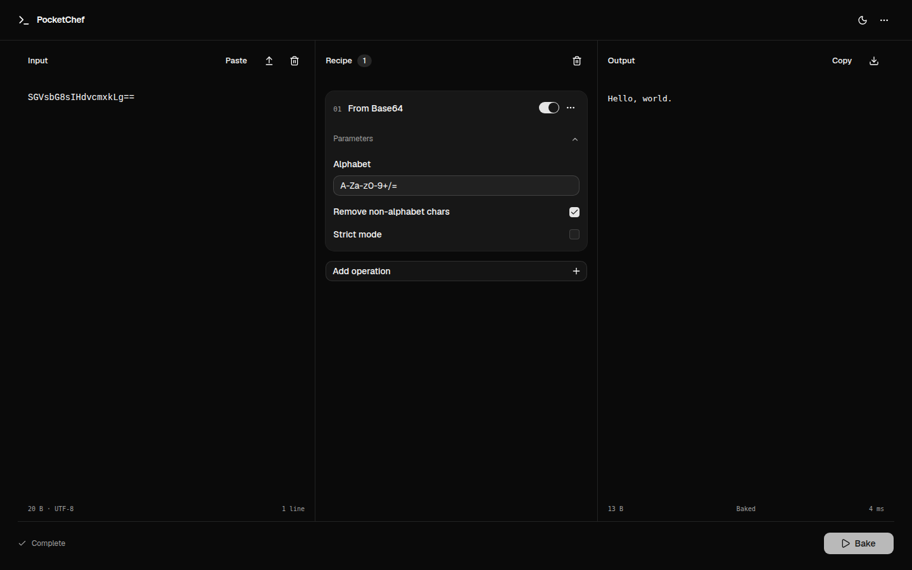
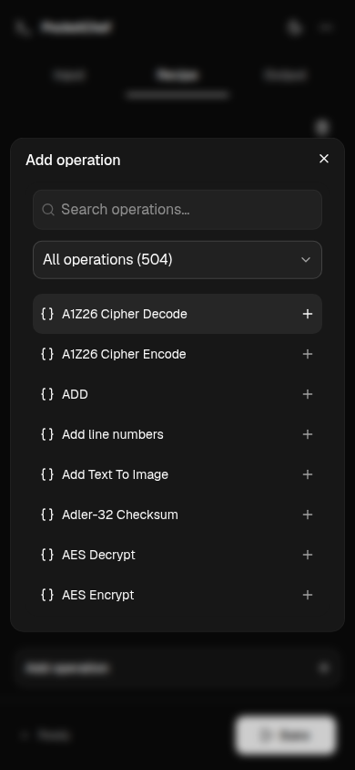

# PocketChef

A minimal, mobile-friendly interface for CyberChef.

<table>
  <tr>
    <th>Desktop</th>
    <th>Mobile</th>
  </tr>
  <tr>
    <td width="78%"></td>
    <td width="22%"></td>
  </tr>
</table>

## Development

Node.js 22.12+

```sh
npm ci
npm run dev
```

## Build

```sh
npm run build
```

Static files are generated in `dist/`.

## Credits

Powered by [CyberChef](https://github.com/gchq/CyberChef). [Engine license](public/engine/LICENSE).
